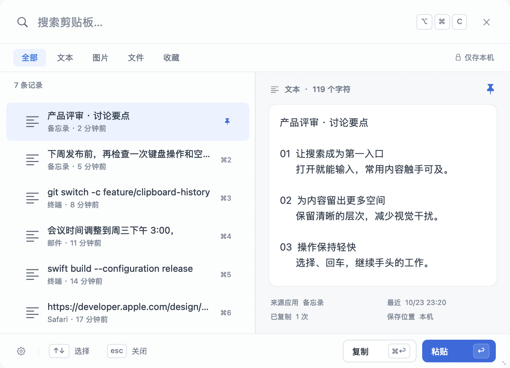

# OtterClip


轻巧的原生 macOS 剪贴板历史工具。收好复制过的文字、图片和文件，按 **⌥⌘C** 随时找回。独立运行，无需安装 Alfred。

[English](README.md) · [下载](https://github.com/dengbiao/OtterClip/releases/latest) · [参与贡献](CONTRIBUTING.md)



## 安装

需要 **macOS 13 或更新版本**。从 [Releases](https://github.com/dengbiao/OtterClip/releases) 下载 `OtterClip-1.2.1-arm64.dmg`，打开后将 **OtterClip** 拖入 Applications（应用程序）。预编译 DMG 适用于 Apple Silicon；Intel Mac 可[从源码构建](#从源码构建)。

当前版本采用 **ad-hoc 本地签名**，未使用 Developer ID 公证。若 macOS 提示无法验证开发者，可按系统提供的「系统设置 → 隐私与安全性 → 仍要打开」流程允许。建议将应用放在固定位置后再授权；重新编译或更换签名后，可能需要重新授予辅助功能权限。

1. 打开 OtterClip，菜单栏会出现小水獭图标，从下一次复制开始保存历史。左键点击图标直接打开设置，右键点击可展开菜单，包含暂停记录与退出等操作。
2. 按 **Option + Command + C** 呼出窗口，输入关键词搜索，使用方向键选择结果。
3. 按 **⌘1–⌘9** 或 **⌘回车** 复制并关闭窗口；按 **回车** 复制、关闭窗口，并粘贴回原应用。
4. 自动粘贴需要辅助功能权限。未授权时，会先弹窗说明内容已复制；点「前往授权」可直接打开系统辅助功能设置，或点「稍后」返回原应用手动按 **⌘V** 粘贴。也可以从设置 →「隐私」中授权。

界面目前为简体中文。系统若询问剪贴板访问，请按需允许。

## 功能

- 保存纯文本、图片、文件和文件夹历史，并提供内容预览。
- 按内容、文件路径、来源应用搜索，支持类型与收藏筛选。
- 相同内容自动去重，收藏置顶，并在常规容量清理时保留。
- 窗口支持缩放并保存窗口尺寸，左右分隔线可拖动调整列表与预览比例。
- 可设置全局快捷键、历史容量、图片/文件记录、应用排除和登录启动。
- 菜单栏可暂停记录，跳过已识别的密码管理器及敏感剪贴板标记。
- 本地原子写入、图片去重、未引用图片回收及损坏历史备份恢复。

| 按键 | 操作 |
| --- | --- |
| ⌥⌘C | 呼出 / 关闭历史窗口（可改） |
| ↑ / ↓ | 选择上一条 / 下一条 |
| 回车 | 复制、关闭窗口，并尝试粘贴回原应用 |
| ⌘回车 | 复制并关闭窗口 |
| ⌘1 … ⌘9 | 复制当前搜索结果中对应的条目并关闭窗口 |
| ⌘P | 收藏 / 取消收藏 |
| ⌘Delete | 删除选中历史 |
| Esc | 关闭并返回原应用 |

输入法正在组词时，方向键、回车和 Esc 交给输入法处理。

## 隐私与限制

**无云同步、网络请求或遥测。剪贴板历史按原文保存在本机，没有额外加密。** 数据目录权限为 `0700`，数据文件权限为 `0600`；文件访问权限不能替代加密。

数据位于 `~/Library/Application Support/ClipShelf/`：

- `history.json`：文字与元数据。
- `Images/`：保存的图片。
- `preferences.json`：偏好设置。

可以从设置中打开数据文件夹。清空未收藏历史会保留收藏和当前系统剪贴板；删除无法撤销。退出应用后删除此目录可移除全部本地数据。损坏文件的恢复备份不会自动删除。

默认保留 300 条未收藏记录，可选 100、300、500 或 1,000 条，收藏不计入条数上限。另有约 16 MiB 文本/路径元数据、100 MiB 图片预算，收藏优先保留。超限内容会跳过：单条文本最多 2 MiB，图片最多 12 MiB / 4,000 万像素（原始输入最多 20 MiB），文件列表最多 1,000 个路径。文件历史仅保存路径，原文件仍需存在。文本按纯文本保存，不保留富文本格式；暂不记录音频、视频和其他自定义格式。

敏感标记过滤和应用排除只覆盖已识别的情形，无法识别所有密码或秘密。需要时请先暂停记录，再复制敏感内容。来源应用按捕获时的前台应用推断，快速切换应用后可能不准确。轮询间隔为 0.5 秒，间隔内连续复制多次可能只记录最后一次。

自动粘贴需要目标应用仍在运行、焦点恢复成功，并获得辅助功能和发送按键权限；部分应用可能不接受模拟 **⌘V**。失败时内容仍在剪贴板中，可手动粘贴。登录启动由 macOS ServiceManagement 管理，可能需要在系统设置中批准。

## 从 ClipShelf 升级

**OtterClip 1.2.0** 是更名后的首个版本。保留内部 Bundle ID `app.clipshelf.mac` 和 `Application Support/ClipShelf` 数据目录，以兼容已有历史和设置。请先退出 ClipShelf，再将 OtterClip 放入 Applications，并移除旧的 ClipShelf 应用。两者使用相同的 Bundle ID，请避免同时运行或安装重复副本。应用名称、位置或签名变化后，macOS 可能要求重新授权，已有权限不保证继承。

## 从源码构建

需要带有 **macOS 15.4 或更新 SDK** 及配套 Swift 工具链的现代 Xcode 或 Apple Command Line Tools。应用运行最低仍为 **macOS 13**，编译剪贴板访问检查需要较新的 SDK。无第三方库依赖，Apple Silicon 和 Intel Mac 均可在本机构建：

```bash
git clone https://github.com/dengbiao/OtterClip.git
cd OtterClip
./scripts/build-app.sh
open build/OtterClip.app
```

默认采用 ad-hoc 签名，也可指定自己的 Developer ID：

```bash
CODE_SIGN_IDENTITY='Developer ID Application: Your Name (TEAMID)' ./scripts/build-app.sh
```

仅设置签名身份不会自动公证。运行以下命令可在 `dist/` 生成应用、DMG 和源码压缩包：

```bash
./scripts/package-release.sh
```

开发预览使用隔离数据，不开启后台记录：

```bash
open build/OtterClip.app --args --demo --no-monitor --show --data-dir /tmp/otterclip-demo
```

## 验证

```bash
./scripts/test-core.sh
swift build
.build/debug/OtterClip --self-test
.build/debug/OtterClip --self-test-ui
```

独立核心检查可在只有 Command Line Tools 的机器上运行。平台检查使用私有命名剪贴板和临时数据。界面检查仅操作应用自身的 AppKit 视图和私有剪贴板，不读写系统剪贴板，也不向其他应用发送键盘或鼠标事件。这些检查不能替代授予权限后的跨应用快捷键和自动粘贴人工验收。

安装**完整 Xcode** 后，还可运行 XCTest：

```bash
swift test
```

macOS CI 会构建并运行核心、XCTest、平台及原生界面检查。

## 许可与图标

[MIT](LICENSE) © 2026 dengbiao。小水獭图标使用 Codex 内置生图工具生成，仓库附有[生成提示词](Assets/AppIcon.prompt.txt)。
